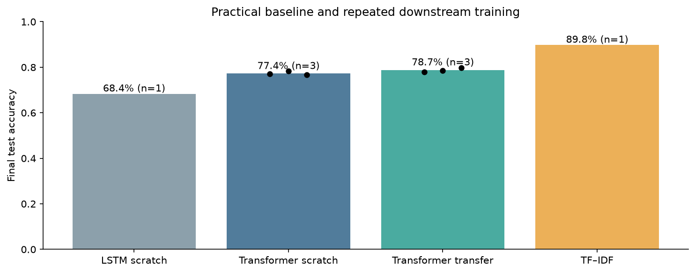
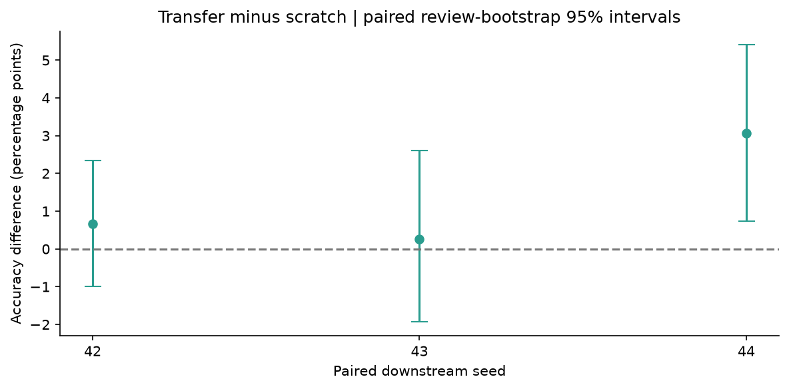

# LexiScope — Language Representation, Decoding & Transfer

[](https://github.com/Pariamazaheri/lexiscope-language-systems/actions/workflows/ci.yml)

LexiScope is an end-to-end benchmark for choosing and evaluating text modeling approaches. It connects static and contextual embeddings, controlled language generation, and pretraining-to-classification transfer in a modular Python package. The project emphasizes valid evaluation, practical baselines and inspectable numerical evidence.

For a movie-review sentiment task, a validation-selected TF–IDF classifier achieved **89.8% final test accuracy**. Compact Transformers averaged **77.4% from scratch** and **78.7% after language-model pretraining**, illustrating both the value and the limits of transfer under a small data and compute budget. These are research benchmark results, not commercial deployment or measured business impact.



## Why this project matters

Teams building text systems need more than a model demo: they need reliable splits, reproducible inference, meaningful uncertainty and a baseline that justifies added complexity. LexiScope provides those controls and exposes the mechanisms behind representation and generation decisions.

## Methodology

**Representation analysis.** Query all 400,000 GloVe 6B-200d vectors for nearest neighbors and semantic/syntactic analogies. Inspect 50 selected terms with t-SNE across three seeds, comparing local-neighbor retention against the original cosine geometry. Extract target-word spans across all 13 BERT states with character-offset alignment and WordPiece mean pooling. Compare the original sentences with pairs where target positions match.

**Decoding analysis.** Run the verified TinyStories-1M checkpoint with greedy, five-beam and temperature/top-k/top-p decoding. Implement reusable sampling and an EOS-aware autoregressive loop. Check custom greedy token IDs against Hugging Face generation on three prompts; preserve all 21 actual generation samples, three prompt uncertainty measurements and deterministic seed settings.

**Language modeling.** Use the existing cleaned *James Watt* corpus, verified against Project Gutenberg. Split its token stream into separated 70/15/15 regions, cap training at 32,768 tokens and validation/test at 4,096 each, then create non-overlapping 64-token input blocks with shifted targets. Train two-layer, width-64 LSTM and causal Transformer bodies with replaceable vocabulary heads.

**Transfer evaluation.** Match all 10,000 existing reviews and labels to the original IMDb archive. Remove 17 normalized duplicates before stratified partitioning: **6,988 train / 1,497 validation / 1,498 test**. Train an LSTM baseline and paired scratch/transfer Transformers at seeds 42, 43 and 44. Each transfer run receives a deep copy of the same restored pretrained body, with a matched classification head and an unchanged causal architecture. Choose checkpoints by validation loss with real early stopping, then evaluate the test set at a fixed 0.5 decision threshold.

**Practical reference.** Fit a train-only TF–IDF + logistic-regression pipeline on the same reviews. Choose the inference model by validation log loss among seed-42 candidates. Save complete local preprocessing/model artifacts and provide a batch prediction command.



## Results and insights

| Model | Test accuracy | Test macro F1 | Scope |
|---|---:|---:|---|
| LSTM scratch | 68.4% | 0.682 | One downstream seed |
| Transformer scratch | 77.4% | 0.773 | Mean of three downstream seeds |
| Transformer transfer | 78.7% | 0.787 | Mean of three downstream seeds |
| TF–IDF reference | **89.8%** | **0.898** | One deterministic fitted pipeline |

- **Transfer is modest and uncertain.** Paired accuracy gains were +0.67, +0.27 and +3.07 percentage points. The first two review-bootstrap 95% intervals include zero. The seeds share a single pretrained checkpoint; they do not measure uncertainty across independent pretraining runs.
- **A lexical reference can be the stronger operational candidate.** TF–IDF won on validation loss and final held-out accuracy. This does not establish that Transformers are generally inferior; the neural runs use small models, short training and 128-token review truncation.
- **Contextual change needs controls.** Original BERT input-layer similarities were 0.958 for *bat* and 0.959 for *charge*. With equal target positions they were 1.000, falling to 0.696 and 0.526 at the final layer. Layer zero includes position/segment embeddings and normalization; it is not the pure static lookup vector. Two examples show context sensitivity, not a general word-sense accuracy score.
- **Projection is illustrative.** The selected terms had original five-neighbor category purity 0.880, but t-SNE retained only 71.6–74.8% of their original nearest neighbors across seeds. A visually clean map cannot prove global semantic separation.
- **Generation has measurable domain limits.** First-token entropy was 1.23 nats for the story prompt versus 5.28 for the technical prompt. These three prompts are diagnostic examples, not an OOD benchmark or hallucination detector.
- **Small-corpus language modeling remains weak.** Test perplexities were 2,186 (LSTM) and 2,053 (Transformer) on the same GPT-2 tokenization. Generated samples remain repetitive and grammatically poor; improvement over initialization does not establish fluent language ability.

Detailed [methodology](docs/methodology.md), [engineering review](docs/quality_review.md), [evidence notebook](notebooks/language_systems.ipynb) and [source provenance](data/README.md) accompany the results.

## Installation

Use Python 3.11 or 3.12 from the repository root:

```bash
git clone https://github.com/Pariamazaheri/lexiscope-language-systems.git
cd lexiscope-language-systems
python -m venv .venv
source .venv/bin/activate
python -m pip install --upgrade pip
python -m pip install torch --index-url https://download.pytorch.org/whl/cpu
python -m pip install '.[dev]'
```

`pyproject.toml` provides compatible ranges. `requirements-lock.txt` records the direct dependency versions used in the published local run. Weights, raw reviews and environments are ignored by Git.

## Reproduce and use

The complete workflow downloads pinned model dependencies and reconstructs the review subset from its source manifest. The official GloVe archive is approximately 822 MB; supplying an existing 200d file avoids that download. No external inference API or paid account is needed.

```bash
lexiscope run --glove-file /path/to/glove.6B.200d.txt
# Or let the workflow retrieve the official GloVe archive:
lexiscope run
```

Stages can also be executed separately:

```bash
lexiscope prepare --glove-file /path/to/glove.6B.200d.txt
lexiscope representations --glove-file /path/to/glove.6B.200d.txt
lexiscope decode
lexiscope train
lexiscope figures
lexiscope predict --input data/example_reviews.csv --output reports/example_predictions.csv
# Inspect a neural model independently of the selected reference:
lexiscope predict --model transformer_transfer --input data/example_reviews.csv --output reports/neural_predictions.csv
```

The prediction input is a CSV with a nonempty `text` column. Output contains the positive probability and sentiment label. Neural inference uses the seed-42 checkpoint and the explicit attention mask; it retains only the first 128 tokens. Probabilities are not calibrated confidence guarantees. Only load trusted local PyTorch/joblib artifacts.

Explore the committed notebook and reports without downloading weights or retraining:

```bash
python scripts/execute_notebook.py
python scripts/validate_results.py
pytest -q
ruff check .
ruff format --check .
python -m build --wheel
```

The benchmark ran in roughly six minutes of aggregate model-training time on the recorded local CPU environment; downloads and embedding analysis are additional. Timings are machine-specific. Repeated training on different software/platforms may vary; CI recomputes published evidence without rerunning training.

## Repository architecture

| Directory | Purpose |
|---|---|
| `src/lexiscope/` | Data contracts, model bodies/heads, training, decoding, evaluation and CLI |
| `data/` | Verified source manifest, attributed corpus and fictional inference examples |
| `notebooks/` | Executed evidence walkthrough |
| `reports/` | Predictions, metrics, checkpoint selections, representation arrays and figures |
| `docs/` | Design decisions and engineering corrections |
| `tests/` | Causality, padding, sampling, checkpoint and leakage contracts |
| `scripts/` | Notebook execution and independent numerical audits |
| `.github/workflows/` | Python 3.11/3.12 lint, tests, evidence checks and wheel build |

## Scope and attribution

This is an independent portfolio implementation of language-model engineering experiments. It provides maintainable training and inference interfaces; live service deployment, representative application data, monitoring and security review are separate operational work. It does not imply prior employment or customer adoption.

Project code is [MIT licensed](LICENSE). Third-party datasets and models retain their own rights and notices. GloVe vectors use PDDL 1.0; BERT uses Apache 2.0. The original TinyStories model card has no explicit license metadata, so its weights are downloaded as an external dependency and are not redistributed here. See [data provenance](data/README.md) for original authors, source revisions and retained notices.
